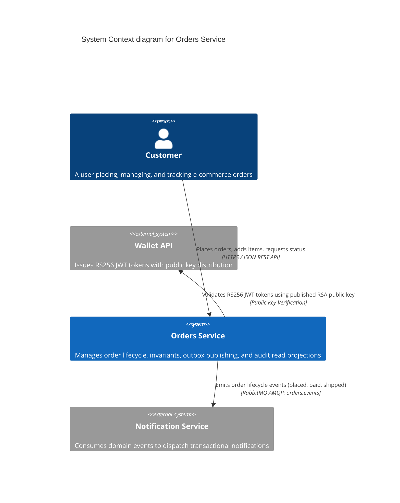
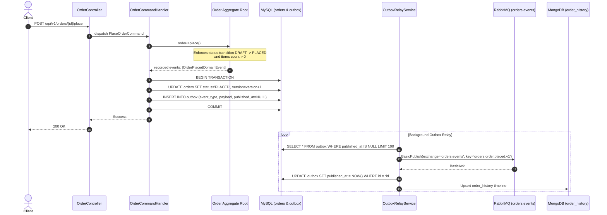

# Architecture Documentation

## 1. C4 Context Diagram

The following diagram illustrates how `orders-service` fits into the overall system landscape, interacting with external users, the identity provider (`wallet-api`), and downstream asynchronous event consumers.



---

## 2. C4 Container Diagram

The internal container diagram of `orders-service` demonstrates the separation between application processes, relational persistence, event messaging, and document projections.

```mermaid
C4Container
    title Container diagram for Orders Service

    Person(client, "Web / Mobile Client", "Interacts via REST API")

    Container_Boundary(ordersBoundary, "Orders Service")
        Container(app, "FrankenPHP / Symfony 7 Application", "PHP 8.3", "Exposes REST endpoints, validates JWTs, processes commands and queries, manages domain invariants")
        Container(relay, "Transactional Outbox Relay Worker", "CLI / Symfony Console", "Periodically scans outbox table and reliably delivers domain events with publisher confirms")
        ContainerDb(mysql, "MySQL 8.0 Database", "Relational Database", "Stores Order aggregate roots, OrderLine entities, and transactional outbox table")
        ContainerDb(mongo, "MongoDB 7.0 Database", "Document Database", "Maintains order_history audit projections for fast multi-dimensional timeline queries")
    end

    Container_Ext(rabbitmq, "RabbitMQ Broker", "AMQP 0-9-1", "Topic exchange 'orders.events' routing domain events to subscribers")

    Rel(client, app, "Sends API requests", "HTTPS/JSON, RS256 Bearer")
    Rel(app, mysql, "Reads and writes aggregates & outbox", "Doctrine ORM 3 (XML)")
    Rel(app, mongo, "Queries order history and projects events", "MongoDB PHP Driver")
    Rel(relay, mysql, "Fetches unpublished events & marks published", "Doctrine DBAL")
    Rel(relay, rabbitmq, "Publishes events with publisher confirms", "AMQP 0-9-1")
```

---

## 3. Data Flow & Transactional Outbox Pattern


